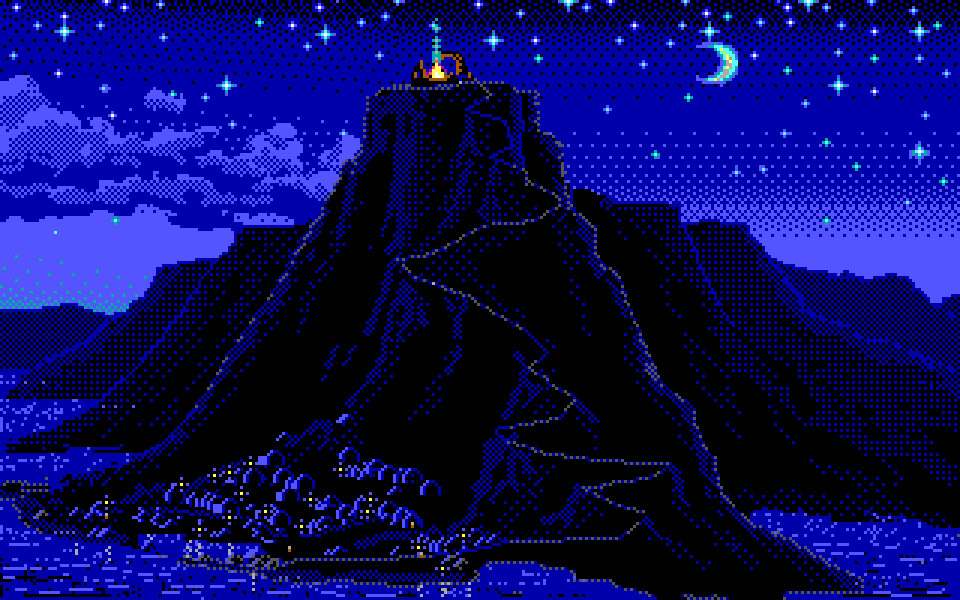
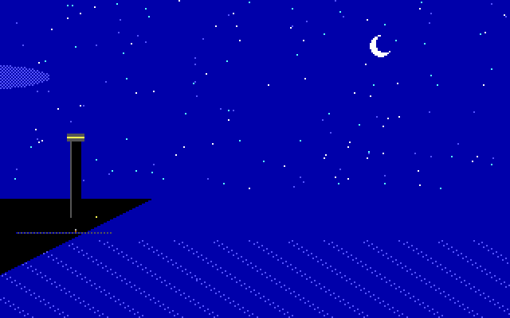

# DOS Scenes

A reusable scene player for real-mode DOS: EGA graphics, AdLib music, small
animated details, and three ways to run the same scene—standalone, resident,
or embedded in another foreground application.

Scene geometry and playlists live in data files. The runtime is shared across
packs rather than compiled around one island or one soundtrack. An original
**Night Coast** demo is generated from source and can be redistributed under
MIT. The first externally sourced pack recreates the island presentation from
[the Video Game History Foundation stream](https://www.youtube.com/watch?v=ikaqus5_QIg).



*Island scene captured from the DOS player in DOSBox-X. Artwork: The Secret of
Monkey Island, Lucasfilm Games (1990); presentation inspired by the
[Video Game History Foundation stream](https://www.youtube.com/watch?v=ikaqus5_QIg).
This documentation screenshot is outside the MIT license; see
[the full credits](scenes/island/CREDITS.md).*

## Features

- 320×200, 16-color planar EGA with hidden-page rendering and palette control.
- Masked moving clouds, sprite animation, timed meteors, slow moon arcs,
  independent window lights, pixel walkers and water ripples.
- Walking paths with pauses, independent one-way journeys and per-pixel
  foreground occlusion. The island routes reach the summit and follow its
  town and dock lanes.
- OPL2 register-stream playback, including rhythm/noise voices. A playlist can
  contain up to 16 tracks; no MIDI interface, samples or floating-point unit is required.
- Keyboard-only volume, saved per scene across player and screensaver restarts.
- AdLib write recovery delays plus a bounded PIT-clock guard and `/SLOWOPL`.
- Standalone `SCENE.EXE`, directly loaded `SCENETSR.EXE`, and a cooperative C API.

## Build

Use Open Watcom 2 and Python3. DOSBox-X is needed for the runtime tests.

```sh
./build.sh --watcom /path/to/watcom
```

Or use the pinned Nix environment:

```sh
nix develop --command python3 tools/build.py
nix develop --command python3 tests/run.py --no-build
```

The build produces `build/SCENE.EXE`, `build/SCENETSR.EXE`, an embedded runtime
object, and `build/scenes/demo`. It does not create a DOS setup program.
Copy the executables and the scene directory to your DOS disk.

## Run a scene

For example, copy the demo to `C:\SCENES\DEMO`, then run:

```dos
SCENE C:\SCENES\DEMO
```

| Key | Action |
|---|---|
| `+` / `-` | Raise/lower master volume; `=` / `_` also work |
| `M` | Mute or restart the current track |
| `N` | Next enabled track |
| `Esc` | Exit the standalone player |

Volume changes save to `VOLUME.CFG` in the scene directory after about half a
second without another volume key, and on exit or screensaver wake. Level 0
stays silent after restart. Mute does not replace the saved master level.
Configuration writes happen in the foreground, with a temporary file, backup
and retry after an I/O failure. No volume overlay is drawn.

Useful options:

```dos
SCENE C:\SCENES\DEMO /SLOWOPL
SCENE C:\SCENES\DEMO /SILENT
SCENE C:\SCENES\DEMO /LOG /FRAMES=140 /DUMP
SCENE C:\SCENES\DEMO /AT=1800 /FRAMES=4 /DUMP
```

`/LOG` appends `SCENE.LOG`; L marks an audio problem. `/DUMP` saves the displayed
planes as `LAST.EGA`. `/AT` advances scene animation time for inspection; it
does not seek the music. `/TRACK=n` chooses a starting playlist entry.

## Resident mode

Load the TSR directly from DOS:

```dos
SCENETSR C:\SCENES\DEMO /IDLE=120
```

**Ctrl-Alt-S** requests the scene. After 120 seconds of keyboard inactivity it can
also start automatically. `/IDLE=0` makes it hotkey-only. Volume, M and N remain
available while it is active; other keys wake the foreground application.

```dos
SCENETSR /SHOW
SCENETSR /OFF
SCENETSR /ON
SCENETSR /STATUS
```

The resident request is serviced at a safe DOS idle point through INT 28h.
It deliberately waits while a foreground program does not yield to DOS; it is
not an arbitrary interrupt-time takeover of running games. The TSR requires
DOS 5+, the normal BIOS timer configuration, and a standard VGA 80×25 text screen, page 0. It defers during graphics mode,
critical DOS activity or insufficient free scene memory. Keyboard inactivity is
the idle trigger; mouse movement is not tracked.

Hardware IRQs only update requests and idle counters. The scene runs on a private
stack with the resident PSP/DTA, then restores the caller's PSP, DTA, clock hook,
text, font, palette and cursor. Temporary DOS break/critical-error handlers protect resident file operations
and are restored on wake. Scene allocations are released after wake. The
current build retains about 102 KiB, plus the chosen scene's working memory while
active. `/OFF` disables activation; reboot removes the resident code. There is
no setup program, boot-file editor or automatic TSR installation.

## Scenes and assets



A pack is an ordinary DOS directory. The basic requirement is a 32,000-byte
`SCENE.EGA`. Optional files provide masks, sprites, music and detail animation.
See [the scene format](docs/scene-format.md) and [adding a scene](docs/authoring.md).

```sh
python3 tools/make_demo.py --output build/scenes/demo
python3 tools/pack_island.py --assets /path/to/local/extracted-assets
```

The island pack uses locally obtained game/video assets and arrangements.
The playable assets are **not distributed here** and are not relicensed under
MIT. The documentation screenshot above is provided separately from the code. Its concept
reference is *The Secrets of Monkey Island – An Evening With Ron Gilbert*,
published by The Video Game History Foundation. See [island credits and source
links](scenes/island/CREDITS.md) for the video, game artwork, all song arrangers
and the disabled opening tune. [The extraction guide](scenes/island/README.md)
describes rebuilding a private pack.

The enabled island playlist is **Blow the Man Down**, **Haul Away, Joe!**, and
**Homeward Bound**. **Nelson's Blood** is intentionally disabled. Oceans are
synthesized by OPL2 rhythm/noise voices in the supplied local performances.
The moon follows a projected setting arc, leaving view over about an hour;
it stays out of view until the scene restarts.

## Embedding and NETFTP

The runtime's [C interface](src/dos_scenes.h) is usable from C or C++:

```c
if (dsBegin("C:\\SCENES\\ISLAND")) {
    while (!wake_requested()) {
        service_application();
        dsStep();
    }
    dsEnd();
}
```

Call `dsStep()` frequently from the foreground and forward music keys through
`dsKey()`. The host owns text-state preservation and its wake policy. The runtime
temporarily owns PIT channel 0/IRQ 0, chains the BIOS-rate timer, and expects the
normal BIOS clock configuration on entry. It restores that timer configuration
and its previous IRQ 0 vector on exit. [The embedding guide](docs/embedding.md)
describes lifecycle, memory, volume and mTCP integration.

The [LoC mTCP fork](https://github.com/bstar/mTCP) references this repository for
NETFTP's Island option. NETFTP calls the cooperative API between packet polls;
it does not load the TSR or launch an external scene process. The MIT runtime
and mTCP's GPL application retain their respective licenses.

## Compatibility and validation

The player uses integer real-mode code and requires EGA/VGA with enough video
memory for two display pages. A 286 or faster is the practical target. AdLib is
optional; the scene remains usable without it. No EMS/XMS or 387 is required.
The island's graphics/music buffers use roughly 270 KiB in addition to the
executable, stack and surrounding application. Other packs may use much less.

AdLib address/data writes retain the standard status-port read delays and add
clock-based recovery checks. `/SLOWOPL` doubles the compatibility delay without
changing CPU speed. The additional guard has a bounded retry count and falls
back to the classic delays if the PIT does not advance. See
[hardware timing and references](docs/timing.md).

Tests run real DOS executables under DOSBox-X, including 64,000-pixel readback,
quarter-hour/hour moon positions, volume persistence across processes, TSR
hotkey/idle requests, private-stack entry, foreground restoration, low-memory
and graphics-mode deferral. Emulator cycles are not calibrated MHz. Earlier
island player/NETFTP versions were also tested on a physical 386SX-16 with AdLib;
resident-mode validation is currently emulated.

## License

[MIT](LICENSE) for the original runtime, tools and demo. External game artwork,
video imagery, arrangements and toolchain components retain their original terms.
